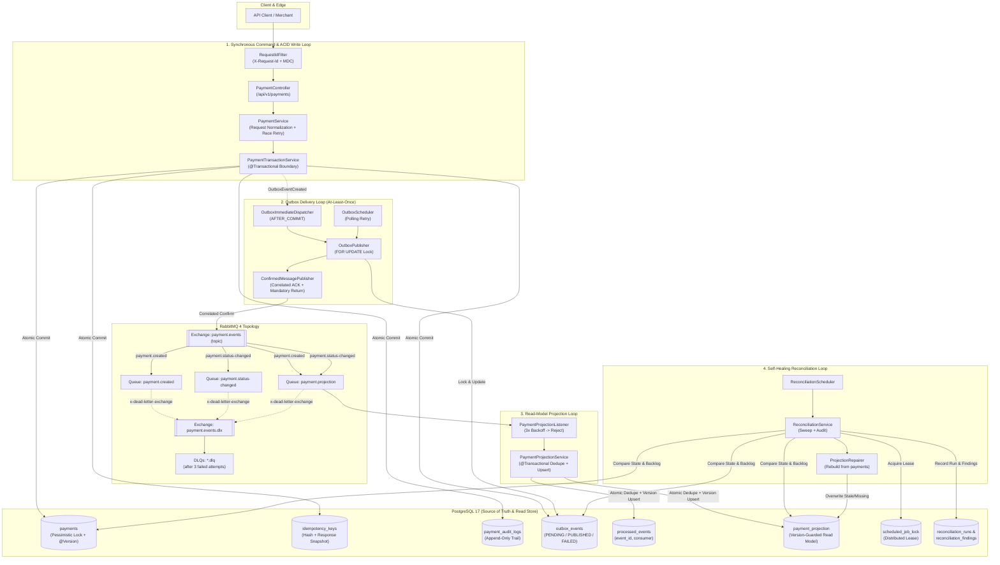

# Payment Core

A production-grade payment processing sandbox built with **Java 21** and **Spring Boot 4.1**, engineered to demonstrate how a financial transaction service maintains **atomic state transitions, strict idempotency, guaranteed at-least-once event delivery, idempotent read-model projection, and self-healing reconciliation** under concurrent load and infrastructure failures.

Rather than chasing breadth of surface features, **Payment Core** focuses on the failure modes that break real payment systems: duplicate client retries, concurrent state transitions, dual-write inconsistencies between the database and message broker, silent broker drops, out-of-order or duplicate event consumption, and read-model drift.

---

## Table of Contents

1. [Architectural Philosophy](#1-architectural-philosophy)
2. [System Architecture](#2-system-architecture)
3. [Module & Dependency Architecture](#3-module--dependency-architecture)
4. [Data Model & Database Invariants](#4-data-model--database-invariants)
5. [Core State Machines & Protocols](#5-core-state-machines--protocols)
   - [5.1 Payment Lifecycle](#51-payment-lifecycle)
   - [5.2 Request Idempotency & Response Snapshotting](#52-request-idempotency--response-snapshotting)
   - [5.3 Transactional Outbox with Correlated Publisher Confirms](#53-transactional-outbox-with-correlated-publisher-confirms)
   - [5.4 Idempotent Read-Model Projection (CQRS-Lite)](#54-idempotent-read-model-projection-cqrs-lite)
   - [5.5 Lease-Guarded Scheduled Reconciliation](#55-lease-guarded-scheduled-reconciliation)
6. [Quick Start](#6-quick-start)
7. [API Reference](#7-api-reference)
8. [Security Architecture](#8-security-architecture)
9. [Observability: Correlation, Metrics, Logs & Health](#9-observability-correlation-metrics-logs--health)
10. [Configuration Reference](#10-configuration-reference)
11. [Verification & Quality Gates](#11-verification--quality-gates)
12. [Architecture Decision Records & Operational Docs](#12-architecture-decision-records--operational-docs)
13. [Roadmap](#13-roadmap)

---

## 1. Architectural Philosophy

Payment Core is built around five non-negotiable engineering principles:

1. **Explicit State Machines Over Ad-Hoc Booleans:** Every lifecycle—payment transitions (`PaymentAction`), idempotency outcomes (`PaymentCreationOutcome`), transition outcomes (`PaymentTransitionOutcome`), outbox delivery (`OutboxStateMachine`), projection consumption (`ProjectionOutcome`), reconciliation (`ReconciliationOutcome`), and security posture (`SecurityMode`)—is modeled as an explicit state machine with deterministic transitions.
2. **Database Constraints as the Final Line of Defense:** Application code enforces invariants first; PostgreSQL `CHECK`, `UNIQUE`, `FOREIGN KEY`, and lifecycle timestamp invariants (`V1`–`V8` Flyway migrations) enforce them last. Even a bug in application code cannot persist a `CAPTURED` payment with a null `captured_at` timestamp or an invalid status.
3. **No Dual Writes—Ever:** Every payment mutation writes the aggregate (`payments`), the audit trail (`payment_audit_logs`), the idempotency snapshot (`idempotency_keys`), and the integration event (`outbox_events`) inside a **single ACID database transaction**.
4. **Honest Distributed Systems Semantics:** Because end-to-end "exactly-once" delivery across PostgreSQL and RabbitMQ does not exist without two-phase commit, the system combines **at-least-once outbox publishing** (verified via correlated broker ACKs and mandatory routing returns) + **idempotent consumer deduplication** (`processed_events`) + **monotonic aggregate version guards** (`WHERE version < excluded.version`) + **periodic reconciliation** against the source of truth.
5. **Executable Architecture:** Layering and module boundaries are enforced at build time by **ArchUnit** (`ArchitectureTest`), not left to rot in wiki diagrams.

---

## 2. System Architecture

The runtime consists of **four cooperating control loops** sharing PostgreSQL 17 and RabbitMQ 4:



### Technology Stack

| Layer | Technology | Role in Architecture |
| --- | --- | --- |
| **Language & Runtime** | Java 21 (Temurin), Spring Boot 4.1.2 | Virtual-thread ready runtime, strict constructor-bound `@Validated` configuration, RFC 9457 Problem Details |
| **Transactional Store** | PostgreSQL 17 + Flyway (`V1`–`V8`) | ACID source of truth, row-level pessimistic locking (`SELECT ... FOR UPDATE`), schema-level state invariants, distributed job lease |
| **Message Broker** | RabbitMQ 4 (AMQP 0-9-1) | Durable topic exchange (`payment.events`), correlated publisher confirms, mandatory unroutable returns, dead-letter topology (`payment.events.dlx`) |
| **Cache Infrastructure** | Redis 8 | Provisioned in local stack & Testcontainers for rate limiting and hot idempotency caching |
| **Security** | Spring Security + OAuth2 Resource Server | Explicit `SecurityMode` (`OPEN` for local sandbox, `JWT` for OIDC bearer auth); fail-fast startup policy in `prod` if `OPEN` |
| **Observability** | Micrometer + Prometheus + ECS JSON Logging | Low-cardinality domain/outbox/projection/reconciliation metrics, `X-Request-Id` MDC correlation, custom `OutboxHealthIndicator` |
| **Quality & Architecture** | Testcontainers, ArchUnit, JaCoCo, Maven Enforcer | Real PostgreSQL/RabbitMQ/Redis integration tests, executable package boundary rules, >= 80% line coverage gate, GitHub Actions CI |

---

## 3. Module & Dependency Architecture

The codebase is organized into four top-level bounded packages under `com.paymentcore`. Dependency direction is strictly enforced by [`ArchitectureTest`](src/test/java/com/paymentcore/architecture/ArchitectureTest.java):

```text
src/main/java/com/paymentcore
├── common                         # Cross-cutting infrastructure (zero dependencies on feature modules)
│   ├── api                        # Generic RFC 9457 Problem Details handler, PageResponse contract
│   ├── config                     # SecurityMode, SecurityModePolicy (prod fail-fast), OpenAPI config
│   └── observability              # RequestIdFilter (header validation, UUID generation, MDC lifecycle)
│
├── payment                        # Core write-side domain & outbox publisher (independent of ledger/reconciliation)
│   ├── api                        # PaymentController, PaymentExceptionHandler (domain Problem Details)
│   ├── dto                        # Request/response records (depend only on payment.domain)
│   ├── domain                     # Pure domain model: Payment (aggregate + stored limits), PaymentAction
│   │                              # (target status, allowed sources, timestamp, audit label),
│   │                              # PaymentTransitionOutcome, IdempotencyRecord, PaymentAuditLog
│   │                              # (zero outer-layer dependencies)
│   ├── service                    # PaymentService (use cases, race retry), PaymentRequestNormalizer
│   │                              # (validation, canonical form, SHA-256 v1 fingerprint),
│   │                              # PaymentTransactionService (ACID boundary), PaymentMetrics
│   ├── repository                 # Spring Data JPA repositories (pessimistic locking queries)
│   ├── event                      # Published contract: PaymentCreatedEvent, PaymentStatusChangedEvent,
│   │                              # PaymentEventType, PaymentEventHeaders & RabbitMQ exchange/queue/DLQ topology
│   └── outbox                     # OutboxEvent, OutboxStateMachine, OutboxPublisher, ConfirmedMessagePublisher,
│                                  # OutboxImmediateDispatcher, OutboxScheduler, OutboxHealthIndicator
│
├── ledger                         # Read-model projection consumer (depends on payment.event only)
│   ├── LedgerConsumerConfiguration # Listener container (retry + DLQ) and the JSON message converter
│   ├── PaymentProjectionListener  # Queue listener on payment.projection
│   ├── PaymentProjectionService   # Atomic deduplication + version-guarded projection update
│   ├── PaymentProjectionStore     # Single-statement projection upserts (event apply, repair)
│   └── ProcessedEventStore        # INSERT ... ON CONFLICT DO NOTHING delivery deduplication
│
└── reconciliation                 # Self-healing background verification (SQL over the tables, + lease)
    ├── DatabaseJobLock            # PostgreSQL lease (scheduled_job_lock) preventing concurrent sweeps
    ├── ReconciliationScheduler    # Periodic trigger
    ├── ReconciliationService      # Sweep: compares payments vs projection & outbox backlog, records findings
    ├── ReconciliationStore        # Drift, orphan and backlog queries
    ├── ProjectionRepairer         # Rebuilds missing/stale projections from source of truth
    └── ReconciliationRunStore     # Persists reconciliation_runs and reconciliation_findings
```

### Enforced Architectural Rules (`ArchitectureTest`)

- **`domain` Purity:** `com.paymentcore.payment.domain..` has zero dependencies on `api`, `service`, `repository`, `outbox`, `event`, or `dto`.
- **Strict Layering:** Controllers (`payment.api`) cannot access repositories or outbox internals; `payment.outbox` cannot depend on `payment.api` or `payment.service`; `payment.dto` depends only on `payment.domain`.
- **Acyclic Slices:** All slices inside `com.paymentcore.payment.(*)..` are verified free of dependency cycles.
- **Cross-Module Isolation:**
  - `common` never depends on `payment`, `ledger`, or `reconciliation`.
  - `payment` never depends on downstream modules (`ledger` or `reconciliation`).
  - `ledger` depends on the published event contract only (`payment.event`): never on the write-side `domain`, `service`, `repository`, `outbox` or `dto` packages, and never on `reconciliation`.
  - `reconciliation` never imports `payment.*` — it compares and repairs through SQL on the tables — and never depends on web/API layers. Its only cross-module dependency is `ledger.PaymentProjectionStore`, which owns the projection writes it repairs through; `ledger` never depends on `reconciliation`.
- **DI & Naming Discipline:** Field injection (`@Autowired` on fields) is banned across the entire codebase; naming conventions (`*Controller`, `*Service`, `*Repository`, `*Properties`) are mechanically enforced.

---

## 4. Data Model & Database Invariants

Flyway manages 9 tables across migrations [`V1` through `V8`](src/main/resources/db/migration). PostgreSQL constraints guarantee that invalid states cannot be persisted even if application logic is bypassed:

| Table | Migration | Purpose | Key Database Invariants & Indexes |
| --- | --- | --- | --- |
| `payments` | `V1`–`V3` | Write-side payment aggregate | `ck_payments_amount_positive` (`amount > 0`), `ck_payments_status` enum check, `ck_payments_lifecycle_timestamps` (enforces exact non-null/null timestamp combinations per status), optimistic `@Version` |
| `idempotency_keys` | `V3`, `V4`, `V7` | Client request deduplication & response snapshot | `uq_idempotency_keys_key` (`UNIQUE`), `fk_idempotency_keys_payment`, `idx_idempotency_keys_created_at` |
| `payment_audit_logs` | `V1`–`V3` | Append-only state transition history | `fk_payment_audit_logs_payment`, `ck_payment_audit_event_type`, `ck_payment_audit_from_status`, `ck_payment_audit_to_status` |
| `outbox_events` | `V3`, `V4` | Transactional outbox queue | `ck_outbox_events_status` (`PENDING`, `PUBLISHED`, `FAILED`), polling index `idx_outbox_events_due` on `(status, next_attempt_at)`, partial `idx_outbox_events_failed` on failed rows |
| `payment_projection` | `V5`, `V8` | Read-optimized query projection | Primary key `payment_id`, updated via atomic `ON CONFLICT DO UPDATE WHERE version < excluded.version` |
| `processed_events` | `V5` | Consumer delivery deduplication log | Composite PK `(event_id, consumer)` used with `INSERT ... ON CONFLICT DO NOTHING` |
| `scheduled_job_lock` | `V6` | Distributed scheduler lease | PK `job_name`, `locked_until`, `locked_by` acquired via atomic conditional `UPDATE` |
| `reconciliation_runs` | `V6` | Audit record of each reconciliation sweep | `ck_reconciliation_runs_status` (`RUNNING`, `COMPLETED`, `FAILED`), counters for checked/mismatches/repaired/orphans/outbox |
| `reconciliation_findings` | `V6` | Individual anomalies found during a sweep | `fk_reconciliation_findings_run`; the `type` vocabulary is owned by `ReconciliationFindingType` (`MISSING_PROJECTION`, `STALE_PROJECTION`, `ORPHAN_PROJECTION`, `OUTBOX_PENDING_STUCK`, `OUTBOX_FAILED`) |

---

## 5. Core State Machines & Protocols

For the complete formal specification of all 13 domain and infrastructure state machines, see [`docs/state-machines.md`](docs/state-machines.md).

### 5.1 Payment Lifecycle

```text
INITIATED ──authorize──► AUTHORIZED ──capture──► CAPTURED ──refund──► REFUNDED
    │                        │
    ├────────cancel──────────┴──► CANCELLED
    │                        │
    └─────────fail───────────┴──► FAILED
```

| From \ Action | `AUTHORIZE` | `CAPTURE` | `REFUND` | `CANCEL` | `FAIL` |
| --- | --- | --- | --- | --- | --- |
| **`INITIATED`** | `AUTHORIZED` | `409 Conflict` | `409 Conflict` | `CANCELLED` | `FAILED` |
| **`AUTHORIZED`** | *Idempotent Replay* | `CAPTURED` | `409 Conflict` | `CANCELLED` | `FAILED` |
| **`CAPTURED`** | `409 Conflict` | *Idempotent Replay* | `REFUNDED` | `409 Conflict` | `409 Conflict` |
| **`REFUNDED`** | `409 Conflict` | `409 Conflict` | *Idempotent Replay* | `409 Conflict` | `409 Conflict` |
| **`CANCELLED`** | `409 Conflict` | `409 Conflict` | `409 Conflict` | *Idempotent Replay* | `409 Conflict` |
| **`FAILED`** | `409 Conflict` | `409 Conflict` | `409 Conflict` | `409 Conflict` | *Idempotent Replay* |

- **Concurrency Serialization:** Transitions acquire a pessimistic write lock (`SELECT ... FROM payments WHERE id = ? FOR UPDATE`) alongside an optimistic `@Version` column. Two concurrent `authorize` calls execute serially: the first transitions the row and emits an outbox event; the second observes `AUTHORIZED` and returns an idempotent replay (`200 OK`, `Transition-Outcome: REPLAYED`) without duplicating audit or outbox records.
- **Invalid Transitions:** Return `409 Conflict` (RFC 9457 Problem Details) with `code = INVALID_PAYMENT_STATE`, `currentStatus`, `action`, and `targetStatus`.

### 5.2 Request Idempotency & Response Snapshotting

```text
UNUSED Key
  └─► Normalize payload + compute length-prefixed SHA-256 (v1)
        └─► Insert payment + audit + outbox + idempotency_keys (with the serialized creation response)
              └─► STORED
                    ├─► Retry with identical hash  ──► 200 OK (Idempotency-Outcome: REPLAYED, original snapshot)
                    └─► Retry with different hash  ──► 409 Conflict (IDEMPOTENCY_KEY_REUSED)
```

1. **Key Validation:** `Idempotency-Key` header is required on `POST /api/v1/payments` and must match `[A-Za-z0-9._:-]{8,128}`.
2. **Canonical Fingerprinting:** `amount` is scaled to 2 decimal places (`125.5` and `125.50` normalize identically), `currency` is upper-cased ISO 4217, optional strings are trimmed-to-null, and variable-length fields are **length-prefixed** (`v1|125.50|USD|15:ORDER-2026-0001|13:Sandbox order`) before hashing with SHA-256 so field-boundary collisions are impossible.
3. **Immutable Snapshot Replay:** `idempotency_keys` stores the serialized JSON response body at creation time. Replaying a `POST /api/v1/payments` request after the payment has already progressed to `AUTHORIZED` or `CAPTURED` still returns the exact creation snapshot, preserving strict HTTP idempotency semantics.
4. **Concurrent First-Request Race Handling:** If two identical `POST /api/v1/payments` requests arrive simultaneously, PostgreSQL's `uq_idempotency_keys_key` constraint rejects the second insert; `PaymentService` catches the constraint violation, rolls back the losing transaction's payment/audit/outbox writes, and transparently replays the winning snapshot on retry.

### 5.3 Transactional Outbox with Correlated Publisher Confirms

```text
PENDING ──(broker ACK within confirm-timeout)──────────────► PUBLISHED
PENDING ──(NACK / timeout / unroutable return / IO error)──► PENDING (attempts++, next_attempt_at)
PENDING ──(attempts >= max-attempts)───────────────────────► FAILED (held for operator inspection/replay)
```

- **Dual Dispatch Path:** `OutboxImmediateDispatcher` listens for `AFTER_COMMIT` and dispatches immediately in a new transaction (`REQUIRES_NEW`) for low latency; `OutboxScheduler` polls due `PENDING` rows every `5s` as the durable recovery path.
- **Row-Locked Broker Round Trip:** `OutboxPublisher` locks the row with `PESSIMISTIC_WRITE` and delegates to `ConfirmedMessagePublisher`, which sends the message with a unique `CorrelationData` ID and awaits a RabbitMQ publisher confirm (bounded by `app.outbox.confirm-timeout`, default `5s`).
- **Mandatory Routing Guard:** Both `publisher-confirm-type: correlated` and `publisher-returns: true` (`mandatory: true`) are enabled. A message that reaches the exchange but matches no queue is returned and recorded as a failed attempt (`reason="returned"`) instead of being silently dropped by the broker.

### 5.4 Idempotent Read-Model Projection (CQRS-Lite)

- **Dedicated Fan-Out Queue:** `payment.projection` binds to `payment.events` for both `payment.created` and `payment.status-changed` routing keys.
- **Single-Transaction Dedupe + Upsert:** `PaymentProjectionService` executes two SQL statements in one transaction:
  1. `INSERT INTO processed_events (event_id, consumer, processed_at) VALUES (?, 'payment-projection-v1', now()) ON CONFLICT DO NOTHING` — if `0` rows are inserted, the message is a duplicate redelivery and is ignored.
  2. `INSERT INTO payment_projection ... ON CONFLICT (payment_id) DO UPDATE ... WHERE payment_projection.version < excluded.version` — guarantees that out-of-order older events can never overwrite newer state.
- **Poison Message Isolation:** The listener gets up to 3 attempts (1 initial + 2 retries) with exponential backoff, then rejects without requeue (`RejectAndDontRequeueRecoverer`), routing the message through `payment.events.dlx` to `payment.projection.dlq`.

### 5.5 Lease-Guarded Scheduled Reconciliation

Every `app.reconciliation.interval-ms` (default `5m`), `ReconciliationService`:
1. Acquires a TTL-bounded lease in `scheduled_job_lock` (`job_name = 'payment-reconciliation'`). Other replicas skip the tick if the lease is held.
2. Compares `payments` against `payment_projection` (bounded by `batch-size`, default `500`), detecting `MISSING_PROJECTION` and `STALE_PROJECTION` (status or version mismatch).
3. Repairs missing/stale rows in `payment_projection` directly from the `payments` source of truth via `ProjectionRepairer`—never mutating `payments` and never republishing events.
4. Detects `ORPHAN_PROJECTION` (projection without a source payment), `OUTBOX_PENDING_STUCK` (pending longer than `outbox-stuck-after`), and `OUTBOX_FAILED` (exhausted retry budget), recording every run and finding in `reconciliation_runs` and `reconciliation_findings`.

---

## 6. Quick Start

### Prerequisites

- **JDK 21** (verified with Eclipse Temurin 21)
- **Docker Desktop** (for PostgreSQL 17, RabbitMQ 4, Redis 8, and Testcontainers)
- No local Maven installation needed—use the included Maven Wrapper (`./mvnw` or `.\mvnw.cmd`).

### Start Infrastructure & Run Locally

**Windows (PowerShell):**

```powershell
docker compose up -d --wait
.\mvnw.cmd spring-boot:run -Dspring-boot.run.profiles=local
```

**macOS / Linux:**

```bash
docker compose up -d --wait
./mvnw spring-boot:run -Dspring-boot.run.profiles=local
```

### Local Endpoints

| Endpoint | Purpose | Credentials / Notes |
| --- | --- | --- |
| `http://localhost:8080/swagger-ui.html` | Interactive Swagger UI | Public in local mode |
| `http://localhost:8080/v3/api-docs` | OpenAPI 3.0 specification (JSON) | Public in local mode |
| `http://localhost:8080/actuator/health` | Composite health (`db`, `rabbit`, `redis`, `outbox`) | Liveness: `/liveness`, Readiness: `/readiness` |
| `http://localhost:8080/actuator/prometheus` | Prometheus metrics scrape endpoint | Includes `payment.*`, `outbox.*`, `reconciliation.*` |
| `http://localhost:15672` | RabbitMQ Management UI | `payment` / `payment` |

---

## 7. API Reference

| Method | Path | Description | Success Status & Headers |
| --- | --- | --- | --- |
| `POST` | `/api/v1/payments` | Create a payment (requires `Idempotency-Key` header) | `201 Created` (`Idempotency-Outcome: CREATED`) or `200 OK` (`Idempotency-Outcome: REPLAYED`) |
| `POST` | `/api/v1/payments/{id}/authorize` | Transition `INITIATED → AUTHORIZED` | `200 OK` (`Transition-Outcome: APPLIED` or `REPLAYED`) |
| `POST` | `/api/v1/payments/{id}/capture` | Transition `AUTHORIZED → CAPTURED` | `200 OK` (`Transition-Outcome: APPLIED` or `REPLAYED`) |
| `POST` | `/api/v1/payments/{id}/refund` | Transition `CAPTURED → REFUNDED` (full refund) | `200 OK` (`Transition-Outcome: APPLIED` or `REPLAYED`) |
| `POST` | `/api/v1/payments/{id}/cancel` | Transition `INITIATED/AUTHORIZED → CANCELLED` | `200 OK` (`Transition-Outcome: APPLIED` or `REPLAYED`) |
| `POST` | `/api/v1/payments/{id}/fail` | Simulate failure `INITIATED/AUTHORIZED → FAILED` | `200 OK` (`Transition-Outcome: APPLIED` or `REPLAYED`) |
| `GET` | `/api/v1/payments/{id}` | Retrieve a payment by UUID | `200 OK` |
| `GET` | `/api/v1/payments?page=0&size=20` | Paginated list of payments (newest first) | `200 OK` |
| `GET` | `/api/v1/payments/{id}/audit` | Chronological audit trail for a payment | `200 OK` |

### End-to-End Walkthrough

> **Note for Windows PowerShell:** Use `curl.exe` instead of `curl` to avoid PowerShell's `Invoke-WebRequest` alias.

```bash
# 1. Create a payment (returns 201 Created, Idempotency-Outcome: CREATED)
curl.exe -i -X POST http://localhost:8080/api/v1/payments \
  -H "Content-Type: application/json" \
  -H "Idempotency-Key: checkout-2026-0001" \
  -H "X-Request-Id: req-checkout-0001" \
  -d '{
    "amount": 125.50,
    "currency": "USD",
    "merchantReference": "ORDER-2026-0001",
    "description": "Sandbox order"
  }'

# 2. Retry with the same key and equivalent payload (returns 200 OK, Idempotency-Outcome: REPLAYED)
curl.exe -i -X POST http://localhost:8080/api/v1/payments \
  -H "Content-Type: application/json" \
  -H "Idempotency-Key: checkout-2026-0001" \
  -d '{
    "amount": 125.5,
    "currency": "usd",
    "merchantReference": "  ORDER-2026-0001  ",
    "description": "Sandbox order"
  }'

# 3. Walk the payment lifecycle: authorize -> capture -> refund
curl.exe -i -X POST http://localhost:8080/api/v1/payments/{id}/authorize
curl.exe -i -X POST http://localhost:8080/api/v1/payments/{id}/capture
curl.exe -i -X POST http://localhost:8080/api/v1/payments/{id}/refund

# 4. Inspect the immutable audit trail
curl.exe -s http://localhost:8080/api/v1/payments/{id}/audit
```

### Error Contract (RFC 9457 Problem Details)

All validation, state conflict, idempotency conflict, and not-found errors return structured RFC 9457 `application/problem+json` payloads correlated with `requestId`:

```json
{
  "type": "https://paymentcore.dev/problems/idempotency-key-reused",
  "title": "Idempotency key reused",
  "status": 409,
  "detail": "Idempotency-Key 'checkout-2026-0001' was already used with a different request payload.",
  "instance": "/api/v1/payments",
  "code": "IDEMPOTENCY_KEY_REUSED",
  "requestId": "req-checkout-0001",
  "timestamp": "2026-11-08T14:00:00Z"
}
```

---

## 8. Security Architecture

Authentication posture is controlled by the explicit `SecurityMode` enum (`app.security.mode`):

- **`OPEN` (Default for local sandbox):** Permits all payment endpoints without bearer tokens and logs an explicit warning at startup.
- **`JWT` (OAuth2 Resource Server):** Requires a valid JWT bearer token (`Authorization: Bearer <token>`) on all `/api/v1/payments/**` endpoints.
- **Production Fail-Fast Guard (`SecurityModePolicy`):** When the `prod` profile is active, the application **refuses to start** if `app.security.mode=OPEN`. Furthermore, `prod` disables Swagger UI/OpenAPI endpoints and hides detailed actuator health internals (`show-details: never`).

Run in production-hardened JWT mode:

```powershell
$env:SPRING_PROFILES_ACTIVE = "prod,jwt"
$env:OAUTH2_ISSUER_URI = "https://issuer.example.com/realms/payments"
.\mvnw.cmd spring-boot:run
```

---

## 9. Observability: Correlation, Metrics, Logs & Health

| Signal | Implementation Details |
| --- | --- |
| **Correlation (`X-Request-Id`)** | `RequestIdFilter` accepts client `X-Request-Id` matching `[A-Za-z0-9._:-]{8,64}` (rejecting log-forging control characters) or generates a UUID, binds it to SLF4J MDC (`requestId`), echoes it in the response header, and attaches it to RFC 9457 Problem Details. |
| **Structured Logs** | Human-readable console format with `[requestId]` in `local`/default profiles; **Elastic Common Schema (ECS) JSON** on stdout in `prod`. Never logs PANs, secrets, or raw payment bodies. |
| **Metrics (Bounded Cardinality)** | All tags use bounded enums only (never high-cardinality IDs):<br/>• `payment.created{outcome=CREATED\|REPLAYED}`<br/>• `payment.transition{action, outcome=APPLIED\|REPLAYED}`<br/>• `outbox.publish{result=confirmed\|failed, reason}` & `outbox.publish.duration`<br/>• `payment.projection.events{eventType, outcome=processed\|duplicate\|failed}`<br/>• `reconciliation.runs{result}`, `reconciliation.findings{type}`, `reconciliation.repaired`, `reconciliation.duration` |
| **Health Probes** | `/actuator/health/liveness` & `/actuator/health/readiness` enabled. `OutboxHealthIndicator` reports `UP` during normal retry backlogs (preventing pod restart loops during transient broker outages) and turns `DOWN` only when `FAILED` events exceed `OUTBOX_FAILED_HEALTH_THRESHOLD`. |

---

## 10. Configuration Reference

All custom properties are bound to immutable `@Validated` Java records (`OutboxProperties`, `MessagingProperties`, `ReconciliationProperties`, `SecurityProperties`). Invalid values fail at startup. See [`.env.example`](.env.example) for a template.

| Environment Variable | Default | Description |
| --- | --- | --- |
| `SERVER_PORT` | `8080` | HTTP server port |
| `DB_URL` | `jdbc:postgresql://localhost:5432/payment_core` | PostgreSQL JDBC URL |
| `DB_USERNAME` / `DB_PASSWORD` | `payment` / `payment` | PostgreSQL credentials |
| `RABBITMQ_HOST` / `RABBITMQ_PORT` | `localhost` / `5672` | RabbitMQ broker address |
| `RABBITMQ_USERNAME` / `RABBITMQ_PASSWORD` | `payment` / `payment` | RabbitMQ credentials |
| `REDIS_HOST` / `REDIS_PORT` | `localhost` / `6379` | Redis address |
| `SPRING_PROFILES_ACTIVE` | *(unset)* | `local` (debug logs), `jwt` (OAuth2 Resource Server), `prod` (hardened) |
| `SECURITY_MODE` | `OPEN` (`JWT` in `prod`) | `OPEN` or `JWT` (`prod` rejects `OPEN` at startup) |
| `OAUTH2_ISSUER_URI` | *(unset)* | OIDC issuer URI when `JWT` mode is active |
| `OUTBOX_ENABLED` | `true` | Enable scheduled outbox retry polling |
| `OUTBOX_MAX_ATTEMPTS` | `5` | Max publish attempts before a row transitions to `FAILED` |
| `OUTBOX_RETRY_DELAY` | `10s` | Backoff delay between outbox publish retries |
| `OUTBOX_POLL_INTERVAL_MS` | `5000` | Scheduler polling interval (ms) for due `PENDING` outbox rows |
| `OUTBOX_CONFIRM_TIMEOUT` | `5s` | Max wait for RabbitMQ correlated publisher ACK |
| `OUTBOX_FAILED_HEALTH_THRESHOLD` | `100` | Max `FAILED` outbox rows before `outbox` health indicator reports `DOWN` |
| `LEDGER_CONSUMER_ENABLED` | `true` | Enable the `payment.projection` read-model listener |
| `RECONCILIATION_ENABLED` | `true` | Enable scheduled reconciliation sweeps |
| `RECONCILIATION_INTERVAL_MS` | `300000` | Interval (ms) between reconciliation sweeps (`5m`) |
| `RECONCILIATION_INITIAL_DELAY_MS` | `30000` | Initial delay (ms) after startup before first sweep |
| `RECONCILIATION_BATCH_SIZE` | `500` | Max mismatched/orphan rows processed per sweep |
| `RECONCILIATION_OUTBOX_STUCK_AFTER` | `10m` | Age threshold before a `PENDING` outbox row is flagged as `OUTBOX_PENDING_STUCK` |
| `RECONCILIATION_LOCK_TTL` | `10m` | Distributed lease TTL in `scheduled_job_lock` |

---

## 11. Verification & Quality Gates

Integration tests use **Testcontainers** with pinned PostgreSQL 17, RabbitMQ 4, and Redis 8 images (`TestcontainersConfiguration`). Ensure Docker is running before executing the test suite:

```powershell
# Run unit, architecture, and Testcontainers integration tests
.\mvnw.cmd test

# Run full verification gate (tests + JaCoCo >= 80% line coverage check + package)
.\mvnw.cmd verify
```

### Build & Test Matrix

| Test Suite | What It Verifies |
| --- | --- |
| [`PaymentApiIntegrationTest`](src/test/java/com/paymentcore/payment/api/PaymentApiIntegrationTest.java) | Full HTTP lifecycle (`create → authorize → capture → refund`, `cancel`, `fail`), idempotent snapshot replay after state changes, canonical hash equivalence (`125.5` vs `125.50`), length-prefixed collision resistance, concurrent `authorize` serialization, audit trail, outbox publication |
| [`PaymentMessagingConfigurationTest`](src/test/java/com/paymentcore/payment/event/PaymentMessagingConfigurationTest.java) & [`OutboxHealthIndicatorTest`](src/test/java/com/paymentcore/payment/outbox/OutboxHealthIndicatorTest.java) | DLQ arguments and bindings on the topology; health contributor thresholds (pending rows are detail, exhausted rows turn `DOWN`) |
| [`OutboxBrokerFailureIntegrationTest`](src/test/java/com/paymentcore/payment/outbox/OutboxBrokerFailureIntegrationTest.java) | Stops RabbitMQ inside the container (`rabbitmqctl stop_app`), verifies payment API still succeeds with outbox `PENDING` (`attempts=1`, `last_error` populated), restarts RabbitMQ, and verifies automatic recovery via scheduler |
| [`ConfirmedMessagePublisherTest`](src/test/java/com/paymentcore/payment/outbox/ConfirmedMessagePublisherTest.java) & [`OutboxPublisherTest`](src/test/java/com/paymentcore/payment/outbox/OutboxPublisherTest.java) | Correlated ACK, broker NACK, confirm timeout, mandatory unroutable return, and connection failure state transitions |
| [`LedgerConsumerIntegrationTest`](src/test/java/com/paymentcore/ledger/LedgerConsumerIntegrationTest.java) | End-to-end outbox → RabbitMQ → `payment_projection` flow, duplicate `messageId` suppression via `processed_events`, out-of-order stale version rejection, poison JSON routing to `payment.projection.dlq` |
| [`ReconciliationIntegrationTest`](src/test/java/com/paymentcore/reconciliation/ReconciliationIntegrationTest.java) & [`ProjectionMismatchTest`](src/test/java/com/paymentcore/reconciliation/ProjectionMismatchTest.java) | Detection and repair of `MISSING_PROJECTION` and `STALE_PROJECTION` (status, version, amount or currency), truthful finding details, reporting of `ORPHAN_PROJECTION` and `OUTBOX_FAILED`, idempotency across consecutive sweeps, distributed lease contention (`SKIPPED`) |
| [`RequestIdFilterTest`](src/test/java/com/paymentcore/common/observability/RequestIdFilterTest.java) & [`RequestIdIntegrationTest`](src/test/java/com/paymentcore/common/observability/RequestIdIntegrationTest.java) | Header propagation, malformed/control-character header rejection, Problem Details correlation |
| [`SecurityModePolicyTest`](src/test/java/com/paymentcore/common/config/SecurityModePolicyTest.java) | Fail-fast startup rejection when `prod` profile is paired with `SecurityMode.OPEN` |
| [`PaymentLifecycleTest`](src/test/java/com/paymentcore/payment/domain/PaymentLifecycleTest.java) & [`OutboxStateMachineTest`](src/test/java/com/paymentcore/payment/outbox/OutboxStateMachineTest.java) | The full transition table (allowed edges and the statuses that accept no action), replay recognition, and a check that every action stamps exactly its target lifecycle timestamp |
| [`ArchitectureTest`](src/test/java/com/paymentcore/architecture/ArchitectureTest.java) | ArchUnit rules for domain purity, controller/repository separation, cross-module isolation (`common`, `payment`, `ledger`, `reconciliation`), slice cycle freedom, and zero field injection |

### Container Image

Build the hardened multi-stage container image (JDK 21 build stage → JRE 21 non-root runtime user with `/actuator/health/liveness` `HEALTHCHECK`):

```bash
docker build -t payment-core:local .
```

---

## 12. Architecture Decision Records & Operational Docs

Detailed design rationale and incident procedures live alongside the code in [`docs/`](docs):

- **[Explicit State Machines (`docs/state-machines.md`)](docs/state-machines.md):** Complete reference for all 13 state machines across domain, persistence, messaging, and runtime layers.
- **[Production Readiness Guide (`docs/production-readiness.md`)](docs/production-readiness.md):** Engineering checklist covering failure modes prevented, verification tests, cardinality rules, and known trade-offs.
- **[Operational Runbook (`docs/runbook.md`)](docs/runbook.md):** Symptom-driven incident playbooks (growing outbox backlog, RabbitMQ outage, 5xx spikes, `FAILED` outbox replay SQL, DLQ inspection, failed Flyway migrations, projection drift, and stuck lease recovery).
- **[ADR 0001 — Transactional Outbox with Publisher Confirms](docs/adr/0001-outbox-publisher-confirms.md):** Why dual writes and fire-and-forget AMQP sends fail, and how row-locked correlated confirms close the gap.
- **[ADR 0002 — Projection Consumer and Scheduled Reconciliation](docs/adr/0002-projection-consumer-and-reconciliation.md):** Why at-least-once delivery + transactional deduplication + aggregate version guards + source-of-truth repair is used instead of distributed two-phase commit.

---

## 13. Roadmap

1. **Outbox & DLQ Operations API:** Admin endpoints for replaying `FAILED` outbox rows and controlled DLQ redrive without manual SQL.
2. **Idempotency Retention & Multi-Tenancy:** Scheduled cleanup job using `idx_idempotency_keys_created_at` and merchant-scoped idempotency keys (`(merchant_id, idempotency_key)`).
3. **Partial & Multi-Capture / Multi-Refund Ledger:** Separate `refunds` / `captures` child entities with cumulative amount invariants.
4. **Redis Rate Limiting & Hot Idempotency Cache:** Wire the provisioned Redis 8 instance for per-merchant token-bucket rate limiting and fast-path idempotency lookups.
5. **Incremental Reconciliation:** Watermark-based sweeps on `payments.updated_at` and read-replica offloading for large tables.
6. **Distributed Tracing & Dashboards:** OpenTelemetry trace propagation across HTTP → PostgreSQL → Outbox → RabbitMQ → Projection Consumer, plus prebuilt Grafana dashboards and Prometheus alert rules.
7. **AI Payment Assistant with Guardrails:** Read-only diagnostic assistant restricted to projection/audit views and runbook playbooks with strict PII/privilege boundaries.
